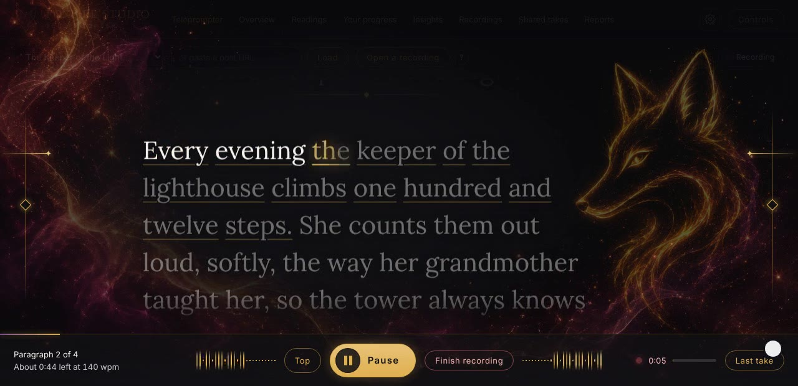

# Foxfire Studio

A teleprompter and recording studio that lives inside WordPress. Pick a post, read it aloud while each word lights up in turn, and get back a clean, podcast-ready MP3 with an honest review of how the reading went. Fix a stumble by editing the words, without recording the whole post again. Then put the reading on the post, where visitors get a listening player.

[](https://foxfirerising.github.io/Foxfire-Studio/videos.html)

**[Download the latest release](https://github.com/FoxfireRising/Foxfire-Studio/releases/latest)** · **[Guides and short videos](https://foxfirerising.github.io/Foxfire-Studio/)** · [What changed](CHANGELOG.md)

## Install in three steps

1. Download `foxfire-studio-<version>.zip` from the [latest release](https://github.com/FoxfireRising/Foxfire-Studio/releases/latest). Leave it zipped.
2. In WordPress: Plugins, then Add New Plugin, then Upload Plugin. Choose the zip, install, activate.
3. A short setup offers itself on first visit. After that, open the studio from Tools, then Teleprompter, or the *Teleprompter* link under any post.

You need WordPress 6.0 or later, PHP 7.4 or later, and a current Chrome, Edge, Firefox or Safari for the person reading. Recording, cleanup and the Whisper review run in the reader's own browser; a recording reaches the site only when the reader chooses to put it there. What the plugin stores, and what it sends where, is in [PRIVACY.md](PRIVACY.md).

> **Status:** stable since 1.0.0, checked automatically before every release (on the newest WordPress and on the oldest it supports, 6.0 with PHP 7.4), and in daily use on a live site. Foxfire Studio is made and looked after by one person in their own time. Problem reports and ideas are welcome under [Issues](https://github.com/FoxfireRising/Foxfire-Studio/issues), and replies come when they can. It is free software under the GPL and comes with no warranty. See [ROADMAP.md](ROADMAP.md) for what comes next.

It started as a way to record audio versions of blog posts so they could be listened to instead of read, and grew into a small voice coach and studio: it can follow your voice, measure your pace and pauses, compare what you said against the script word by word, clean up and master the recording, and let you edit the audio by editing the script. Every part is described below; the [guides](docs/guide/README.md) are the same ones the plugin shows under Foxfire Studio, Help.

---

## Contents

- [What it does](#what-it-does)
- [One plugin](#one-plugin)
- [Repository layout](#repository-layout)
- [Getting started](#getting-started)
- [Using it](#using-it)
- [Where things are stored](#where-things-are-stored)
- [Outside services](#outside-services)
- [Browser support](#browser-support)
- [Troubleshooting](#troubleshooting)
- [Documentation](#documentation)
- [Version history](#version-history)
- [Contributing](#contributing)
- [Licence](#licence)

---

## What it does

### Reading
- Shows any post as large, clean text: title, headings and paragraphs only, with images, embeds and shortcodes stripped out.
- Lights up the text **word by word, karaoke style**. Words already read turn bright, the current word gets a gold sweep, and words ahead wait in a softer tone. The sentence you are in is softly underlined.
- Two ways to move through the text:
  - **Timed pace.** You set words per minute. Each word's time is based on its syllables, with a short beat at commas, a longer one at full stops, and an optional breath between paragraphs.
  - **Follow my voice** (since 1.14.0 with a small speech model on your own device, so your voice never leaves the browser). The word you are reading stays on the reading line. It waits while you pause, holds its place while you ad-lib, follows when you skip ahead or go back to read something again, and shows your pace over the last 30 s. When a take stops, a **first look** gives its length, pace and any paragraph it never heard, before the Whisper review. If the device cannot keep up, timed pace takes over and says why.
- Adjustable text size, column width, **reading line** (where on the screen the current line sits) and **font** (serif, sans serif or the computer's own), all remembered between visits.
- **Cue marks:** mark a pause or a breath after a word, or emphasise a word, without changing the post. Timed pace holds at each pause, the marks are saved with the post so they show on any computer, and the review never counts a pause you marked as a fault.
- **Practice tools:** a three minute **warm-up** (breathing, tongue twisters picked fresh each time, and a passage that lights up at different paces), a **microphone check** (which since 1.9.0 also says how much lift a take will need and whether the room allows it), **opening drills** and a **focus** for each take.
- **Prompter view** (1.5.0) for a glass teleprompter rig or a screen across the room: full screen with only the script, mirrored left to right, upside down or both, with its own size, width and reading line, **Shift** to sit the script over the lens, **Fade above and below**, and bright text on black. Presentation clickers and foot pedals work: Page Down starts and pauses, Page Up goes back a sentence, B blanks the screen.
- Click any word to start from there. Full keyboard control.
- Keeps the screen awake while reading.
- **An intro video** of your choice when the studio opens, with Skip and a switch to stop it playing.

### Recording
- Optional microphone recording that pauses when the reading pauses. It is **lossless**: the raw audio is kept until the final MP3, and the original can be downloaded as a WAV.
- **Crash-safe:** the recording is saved in the browser as it happens, so a frozen tab or closed laptop never loses a take. The teleprompter offers to recover it next time.
- **Audio cleanup** before saving: quiets mouth clicks in the half second before each phrase, softens bumps and creaks in the pauses, and tames whistling S sounds.
- **Speech-model noise reduction:** RNNoise, a small neural network, lowers fans, traffic and room noise while leaving the voice alone, at a Gentle, Medium or Strong setting. The read-out shows the background before and after.
- **Broadcast sound:** softens pops on P and B, filters low rumble, lowers breaths a little, softens harsh S sounds and gently compresses, then levels to a **podcast loudness standard** (-19 LUFS for a mono reading, which plays like -16 on phones) with peaks kept under -1 dB true peak. An **audiobook preset** follows Audible's ACX rules instead. A quiet recording is raised by up to 30 dB, or up to 45 dB when its room is quiet enough to stay under -60 dB (1.9.0), so a phone recording in a quiet room reaches the target too. On a phone, takes are kept in 24 bits.
- **Finishing presets** (1.6.0): one **Finish for** menu for where the reading is going: Podcast, mono (-19 LUFS, the default); Podcast, stereo (-16); Spotify and YouTube (-14, stereo); Broadcast, EBU R128 (-23, a 48 kHz 24-bit stereo WAV); Audiobook (ACX); or Custom (-24 to -12 LUFS, a true peak limit from -3 to -0.5 dBTP, mono or stereo). The file is measured as delivered, both channels counted for stereo, and the studio check reports the **loudness range** (EBU Tech 3342), with a note when it is wide for speech. The review's own **Finish for** menu, beside Download, makes a one-off version for another destination; Use this recording always uses the Settings choice. **Clips** are leveled to -14 LUFS.
- Converts the recording to a **128 kbps MP3** (192 kbps for audiobooks) in the browser with LAME, the standard MP3 encoder, with soft fades so it plays on every phone.
- **Podcast-ready files:** every MP3 carries its title, author, show name, year, a link back to the post and the featured image as artwork, plus **chapters** at the post's headings once the review has run. A Podcasting 2.0 chapters file is offered too.
- **A music bed:** quiet music of your own under a reading, dipping under the voice, with a few seconds alone at the start and a fade at the end. Chosen for the whole show or for each post, with a switch for each take. It is mixed in last, so the review and editing hear the voice alone.
- **Send to my computer:** a phone records well but cannot run the full review, so a take made on a phone can wait on the site, private to you, and open on your computer for the review, editing and Use this recording.
- **Phone take mode** (1.12.0): on a phone, each take goes to the site in pieces of about ten seconds while you record, so a reload, a call or a closed page loses no more than the last few seconds, and the next visit sends whatever is missing. At Stop the take waits on the site for the review on your computer; the phone makes the MP3 only when asked. A large level meter across the bottom says whether your voice is close enough, and a line says how much is on the site. A take cut off partway can be carried on from the sentence before, and Combine takes joins the two. On for phones, with a switch in Controls, Recording.

### Feedback
- **How it went:** a plain-language read-out after each recording covering pace, pauses, whether phrase endings faded, pitch movement, a room check (background noise, clicks, whistles), what the sound processing did, and a **studio check** of the finished MP3 against the podcast or Audible rules.
- **Whisper review:** the open-source Whisper speech model listens back to the recording and compares it with the script. The review studio shows:
  - accuracy, plus every skipped, misread, added or repeated word, and fillers
  - long pauses, hesitations, and sentences that were rushed, slow, flat, unfinished, paraphrased, or faded at the end
  - a score for each paragraph and a colour-coded pace timeline
  - click-to-play on every word and every flag, with words lighting up during playback
  - a comparison of your takes of the same post
  - a captions file (.vtt) timed to your actual reading
- **Teachable listening.** When Whisper mishears a word you said correctly ("Siobhan" heard as "shivon"), one click teaches it, for every post or just the one you are reading, and that pairing is accepted in future reviews.
- **A larger Whisper model** for faster computers: more accurate with names, unusual words and quiet endings, about two to three times slower, chosen beside Whisper review.
- **Share for feedback:** let a friend with an account on your site hear a take with the script lighting up and leave comments pinned to words or moments. You get one email per visit; the share ends after 14 days and its audio is deleted.
- **Open a recording** runs any existing audio file through the same review.
- **Your history follows you:** every take's numbers and the words you have taught Whisper are kept on your site, so the take comparison works across computers. **Use this recording** puts the finished MP3 and its captions on the post in one click.

### Editing
- **Edit the audio by editing the script.** In the review studio, turn on *Edit audio*, select words or fillers (shift-click for more, double-click for a whole sentence) and press **Cut**. Each cut finds the quiet between words and joins with a short crossfade, so edits are not heard.
- **Tidy** suggests cutting fillers and repeats and shortening pauses over 1.5 seconds, with a checklist and a preview of each.
- **Retake** records a sentence again. The new recording is cleaned up the same way, matched to the take's level, and spliced in. If a join sounds off, click a retaken word: **Start** and **End** cut more or less of the old reading 10 ms at a time (for a word heard twice), and **Space before** and **Space after** add a pause of room tone (for words that run together). Each step plays the join.
- **Preview** any edit, **undo** one step at a time, and click a cut to bring it back (a retake has **Bring back the original** in its box). The original recording is never changed.
- **Make edited MP3** masters the edited reading again and moves its captions and chapters to match.
- **Combine takes** (1.3.0) builds one reading from several takes of a post: the second take's opening and the third take's ending, for example. Every reviewed take goes on the post's shelf in your browser (the newest six, for 30 days). Choose a take for each paragraph, or split a paragraph to choose sentence by sentence; each choice shows what that take's review flagged there, and **Best of each** picks the take with the fewest flags, switching only for a clear gain. A take that starts partway, such as a new reading of the last paragraph, supplies what it covers. Joins fall in the pause before a sentence, with that take's own pause, the takes leveled to match; **Hear the join**, and move its **End**, **Start** and **Space** like a retake's. **Build the reading** cleans and masters it once and opens it in the review with the takes' own Whisper words, ready for Edit audio, clips and Use this recording. It is not added to your take history.
- **The take shelf across computers** (1.34.0). Switch on Settings, **Take shelf**, and each person's shelf is kept on the site too, so it follows them to any computer, browser or phone they sign in on: a take reviewed on one is listed on the others at once, ready for Continue and Combine takes, and its recording comes from the site (lossless FLAC, checked sample for sample) the first time Combine takes needs it there. Takes go up in the background after each review, in pieces, and carry on after a reload. Phones send their short takes and never download recordings. Remove and Clear the shelf work everywhere. Off by default; Settings shows the space used, with a limit and Delete every shelf on the site, and Foxfire Studio, Recordings lists your own takes there.
- **Read a long post in parts** (1.4.0). Once a post's shelf has a take, **Continue** beside Combine takes starts the next take one sentence before the first paragraph no take has read, as a run-up. After each review the line says how many paragraphs are left, and the Combine takes screen has a bar across the top showing which take reads each part; click a part to go to it.

### Listening
- **A player on each post with a reading:** play, skip back and ahead, speed, a draggable progress bar, and lock screen controls on phones.
- **Read along:** the post text lights up word by word as it is read, and clicking a word jumps there. It can be switched off in Settings.
- **Chapters:** notches on the progress bar and a list to jump from, read straight from the MP3.
- **Resume where you left off,** and **links that start at a moment** (`?t=1:45`).
- **YouTube and SoundCloud players that load on play** (1.35.0). Switch on Settings, **Embedded players**, for either service, and each of its players in posts, pages and block widgets shows as a picture of the video or track with a play button, at the player's own size. The real player loads only when a visitor presses play and starts at once (YouTube's from its privacy-enhanced address), so pages load faster and visitors contact the service only if they choose to. The site keeps its own copy of each picture. One press works with the keyboard; without JavaScript the panel is a link. A video or track pauses the reading player, and the reading player pauses them. Off by default; nothing in the posts changes.
- **A "read by" credit** under the player's label, from the post's Reading audio box or another custom field.
- **A podcast feed** of every reading, for Apple Podcasts, Spotify and other apps, with cover art, category, rating and each reading's captions as its transcript (Foxfire Studio, Podcast feed).
- Starts as a private preview for editors, then switched on for everyone in Settings.
- **Keep a reading aside** (1.8.0): **Take off the post** on a reading's page moves its file and captions out of the Media Library into a folder visitors cannot open. The post loses its player and the feed loses the episode, while the listening history stays. Foxfire Studio, Recordings lists every reading kept aside with a private player, **Download**, **Put back** (the same address, captions and feed pick, so the same episode, swapping with any newer reading) and **Delete for good**.

### Listener analytics
- **See how each reading is heard:** plays, which parts are heard and heard again, speed changes, skips, where listeners stop, and how each visit ends.
- **Where listeners come from:** the referring site grouped into channels, plus campaign tags on the links you share (`?src=instagram`, or the usual `utm_` tags), so each social post can be compared.
- **Phone, tablet or computer, and country,** from a free country database kept on your site.
- **Private by design:** measured on your own site, no cookies, no outside services, no IP addresses stored, and a listener id that changes every day. Do Not Track and Global Privacy Control are respected, and your own listens are left out.
- **Read or listen, and time to press play** (1.2.0): whether visitors listen instead of reading, do both, read without pressing play, or pass through, and how long they take to press play on phones and on computers.
- **Optional, each off by default** (1.2.0): new and returning listeners (a yes or no from the visitor's own browser), downloads by podcast apps through a short address that counts each one, and a link that also reports plays to the Google Analytics the site already loads.
- **Hard to fake or flood:** the visitor's address comes from the connection itself; forwarding headers count only from proxies you list as trusted, and new page views are limited per listener, per address and per hour for the whole site. Behind a CDN, see [Trusted proxies](SECURITY.md#trusted-proxies).
- A recent listens list in Settings, and a ready-made paragraph for your privacy policy.

### Dashboard
- **A Foxfire Studio menu in WP-admin:** Overview, Readings, Readings to make, Pronunciation, Sources, Your progress, Insights, Recordings, Reports, Settings, Shared takes and Podcast feed. People who can edit posts see their own progress, insights, pronunciation list and shared takes; the listener screens, reports, settings and the feed are for administrators.
- **The listening curve for each reading:** who is still listening at every moment, where people leave and which sentence was playing, what they replay, skip, speed up or slow down.
- **Which channels bring people who stay,** and a link builder for tagged links.
- **Your progress:** pace, accuracy, fillers, retakes, delivery and room over time, personal bests, **goals** checked on every take (also shown in the review studio), a **practice log**, and opening drills on their own.
- **Change markers** on every chart, CSV downloads of every table and of the raw visits, and a plain definition under every screen.
- **Readings to make** (1.4.0): every published post without a reading, with its words, how long it would run at your own pace, and **How hard** (Easy, Some care or Demanding, per 100 words, from long sentences, names, very long words and the words that tripped you or Whisper before; hover for the reasons). **Start** opens the studio on it, and **Hide** takes a post that should not be read aloud off the list.
- **Pronunciation** (1.15.0): every pronunciation note and every word taught to Whisper on one screen, for every post, one post or one word only. Search and filter them, click a note to change it, add one without opening the studio, move a word between every post and one post, and forget a taught word. **Words that may need a note** lists the names and long words in your posts that have none yet, posts still to read first. **Export CSV**, **Export backup** and **Import** (with a preview that only adds).

### Insights
- **What works, in plain sentences:** whether shorter or slower readings, a tag or category, the day and time a reading went out, where listeners came from, and how it was delivered (slips, pitch movement, phrase endings) line up with listeners hearing readings to the end.
- **Honest about the data:** every observation says what it rests on, says nothing until there are enough readings with enough plays and a clear gap, and shows how much more it needs meanwhile.
- **Your own reading:** pace, accuracy, fillers and phrase-ending fade over your full takes, and which way each is moving.
- **In the studio:** when this script at this pace runs longer than the readings your listeners stayed with, a quiet line in the teleprompter says so. The clearest two also appear on the Overview and in the report email.

### Report email
- **How your readings did, in your inbox:** every month on the 1st by default (or weekly, every two weeks or quarterly), with the headline numbers and the change from the period before, top readings, the one that held people and the one that lost them with the sentence where they left, sources, listening habits, new readings and your own recording progress.
- **A Reports screen** with a preview at computer and phone width, Send now, a warning when scheduled jobs run late (with the fix), and every past report.

### Clips for social media
- **A moment of a reading as a short video** for Instagram, Facebook, TikTok or YouTube: square, vertical or wide, with the post's image, a moving waveform, captions with the spoken word lit, the site's address and an end card.
- **Suggested clips** (1.7.0) on each reading's page: the opening and the best three stretches of 30 to 60 seconds, each starting and ending with a sentence, chosen from the reading's captions (paragraph and section edges count for a stretch, a start on "And" or "But" and long pauses count against it) and, once the reading has 10 plays, from what listeners replay and stay through. Each has its first and last words, why it was chosen, ▶, **Make this clip** with its exact length, and **Use for the feed**, which keeps it as the episode's soundbite. After a take in the studio, the clip maker's own suggestions start and end with a sentence too.
- **Suggested moments** from listener data and the voice itself when a reading has no captions, and **captions spelled from the post** using the review's timings or Whisper on just that stretch.
- **A tagged link for each clip,** so Sources shows which clip brought listeners. Made in the browser (Chrome, Edge, Safari or Firefox); download it or save it to the Media Library.
- **Download counting to the IAB guidelines** (1.24.0): podcast downloads (members' feeds included) counted the way the IAB Tech Lab's Podcast Technical Measurement Guidelines (v2.3) describe: once per podcast consumer, episode file and day, once an app has asked for the file's tags and a minute of audio, pieces joined, and test requests, Apple Watch duplicates, bots (from the open OPAWG list), data centres and VPNs left out. Your web server sends the file after counting, so Apple's streaming is counted too (Check counting tries it). Apps and devices by name, podcast consumers a day, sponsor messages delivered, unusual days flagged, a method page to publish, and an optional OP3 prefix. It follows the guidelines and never claims a certificate. Off until switched on.
- **The setup wizard** (1.29.0): a new site is offered a few short steps (the show's name, the look, which posts get readings and where the player goes, privacy and keeping the studio's files on your site) and a one-minute **practice reading** with a microphone check first. Anyone new to the studio in a browser is offered the practice reading once; Settings has **Run setup again**.
- **The player block** (1.28.0): a **Reading player** block for the block editor and the Site Editor (templates, Query Loops, widget areas), showing the post's own reading or **Another reading** you choose, and the `[foxfire_player]` shortcode. A post or template that places the player by hand shows it once, where it is placed; starting one player pauses the others.
- **Accessibility** (1.26.0): the player and the admin screens checked against WCAG 2.2 AA. Buttons named by their own words, a **Transcript** button on every reading with captions, a clear focus ring, a solid panel that reads well on any theme, read along that keeps the post's colours, and a **Readability** check in Settings with **Make it readable**. The studio followed in 1.27.0: its keys act on the script and controls keep their own, dialogs take and give back focus, a word cursor in the script and the review, **?** buttons for help that was only in tooltips, and status read out ([docs/ACCESSIBILITY.md](docs/ACCESSIBILITY.md)).
- **Security review** (1.25.0): a reading's file is checked before anything sends or copies it (a listening file in uploads, never in a private or closed folder), sponsor messages are the site owner's, members' readings sit in folders with random names, and a **Check private folders** button on Podcast feed shows whether your server keeps visitors out of the private folders (with the lines nginx needs).
- **Storage offload** (1.23.0): podcast apps (and, if you like, the player) get the readings from Bunny Storage, any S3-compatible storage (Cloudflare R2, Backblaze B2, Wasabi, Amazon S3) or a CDN in front of the site, taking the heavy downloads off your host. Check this setup tries the storage the way apps and browsers use it before it can be switched on; your site keeps every file, every address falls back to it whenever a copy is missing, and by itself if the storage stops answering. Files for members and everything private stay on your site. Off until switched on.
- **Sponsor slots** (1.22.0): a library of short messages (a sponsor's, or your own shop's or cause's), each recorded in the studio, with dates and the readings it goes on, placed before, in the middle of and after readings in the podcast feed, older episodes included. Each reading gets a sponsored copy made on the site by copying frames, so nothing is encoded again; the mid-roll goes in a pause you choose, and the frames before it are copied again muted, so the reading resumes without a tick. Chapters ("A word from ...") and captions move with it, the episode notes name the sponsor, and the post's own player keeps the reading as it is. Mid-rolls only in longer readings, never in ritual, verse or under the music bed by default. Off until switched on.
- **Member feeds** (1.21.0): each reading can be for Everyone, for Members first for a number of days, or for Members only. Members (by role, by a choice on their profile, or by an active membership plugin) each get a private podcast feed address with the readings for everyone and theirs, for Apple Podcasts, Overcast, Pocket Casts and most other apps, whether or not the public feed is published. A reading for members stays out of the public feed, its files are kept where visitors cannot open them, and its post shows visitors why they cannot hear it, with Sign in and Become a member.
- **Audiobook export** (1.20.0): a collection's Audiobook box makes the opening credits, one MP3 for each reading, the closing credits, a retail sample and the cover, each to the rules of Audible (ACX), which Spotify for Authors and the other stores also accept (192 kbps mono, -20 dB RMS, peaks under -3 dB, room tone at both ends), checks every file and downloads them as one ZIP with a check report. Each chapter is the reading's audiobook copy (its take finished once more for audiobooks, voice only), or is made from its post's MP3 when it has no music bed. The credits are recorded in the studio from a script the box writes, and room tone a reading lacks is made from its own pauses.
- **Collections** (1.19.0): several readings in an order you choose, joined on the site into one MP3 with a chapter for each, every reading copied exactly as it is on its post with silence between. Each collection has its own page with the player and its list of readings, its own captions, and its own podcast episode once published, and joins itself again when one of its readings changes. A reading in another format or at another loudness can be matched in the browser, leaving the post's own reading untouched.
- **Full-length video** (1.18.0) on each reading's page: the whole reading as a wide 1080p video for YouTube, Spotify and video podcast apps, with a picture (the post's, the show's cover art or one chosen), the waveform, the chapter being read and the captions a phrase at a time. It is made in the browser (a 14-minute reading took about 2 minutes on a laptop), kept in the browser's own storage until it downloads, and never put on the site. Beside it: a description with the tagged link and YouTube chapter times, the captions file and a thumbnail, ready for the upload.

### Privacy
- Only logged-in users who can edit posts can open the teleprompter. Visitors never see it, and it asks search engines and page caches to leave it alone.
- Whisper and voice following run on the reader's own device. Recordings and the live audio are never sent to an outside speech service. (Until 1.13.0, *Follow my voice* used the browser's speech recognition, which in Chrome and Edge sent audio to the browser maker; see [PRIVACY.md](PRIVACY.md#follow-my-voice).)
- Listener analytics stays on your site. It stores no IP addresses, sets no cookies and sends nothing to outside services. Full details are in [PRIVACY.md](PRIVACY.md).

---

## One plugin

From 0.1.0 there is one teleprompter: the plugin in `plugin/foxfire-studio/`. It has every feature in this README, a settings screen (Foxfire Studio, then Settings, which is the same screen as Settings, then Foxfire Studio) and two colour presets to start from:

- **Neutral:** charcoal, amber, Lora and Inter.
- **Dark:** void, plum, gold, Cinzel Decorative, Cormorant Garamond and Raleway.

Either one is only a starting point. Every wording, colour and font can be changed afterwards. Since 0.18.0 the studio also has two looks: **Foxfire Studio** (the night sky, the fox and gold ornaments, in the preset's colours) and **My WordPress theme** (no artwork, in the theme's own colours).

Versions before 0.1.0 also came as a page template for a theme. That template has been retired; the plugin does everything it did.

---

## Repository layout

```
foxfire-studio/
├── README.md                  You are here
├── CHANGELOG.md               What changed in each version, and why
├── ROADMAP.md                 Where it's going, version by version
├── CONTRIBUTING.md            How changes are made, tested and released
├── SECURITY.md                How the plugin protects a site, and how to report a problem
├── PRIVACY.md                 What the plugin stores, sends and shows
├── LICENSE                    GNU General Public License, version 2
├── .github/workflows/         The automatic checks GitHub runs on each pull request
├── .github/ISSUE_TEMPLATE/    The forms for reporting a problem or suggesting an idea
├── docs/                      Also the docs site (GitHub Pages): index.md, videos.md, _config.yml, _layouts/, assets/
│   ├── guide/                 The user guides, written by tools/help-export.php
│   ├── media/                 The short videos and stills, made by tools/videos/make.sh
│   ├── ACCESSIBILITY.md       How the plugin was checked for keyboard and screen reader users
│   ├── DESIGN.md              The thinking behind every major decision
│   ├── ARCHITECTURE.md        How the code is organised and how data flows
│   ├── SETUP.md               Installing, updating, self-hosting and deleting
│   ├── ANALYTICS-SPEC.md      Detailed plan for listener and reader stats
│   └── RESEARCH.md            Best practices behind the roadmap, with sources
├── plugin/
│   └── foxfire-studio/
│       ├── foxfire-studio.php   Plugin header and loader
│       ├── includes/            One file per area: settings, the studio page, player, stats, analytics, dashboard, insights, report, clips, sharing, podcast feed
│       ├── views/               The teleprompter page and the share page
│       ├── assets/css/          The studio, player, dashboard, clip maker and share page
│       ├── assets/js/           The studio in a file per part, its engines, the player and the dashboard (see docs/ARCHITECTURE.md)
│       ├── assets/img/          The studio look's artwork
│       ├── assets/vendor/       Mediabunny and its AAC encoder for clips and videos, and the engines that ship with the plugin
│       ├── languages/           foxfire-studio.pot, the template for translations
│       ├── uninstall.php
│       ├── license.txt
│       └── readme.txt
├── tests/                     Unit, PHP, browser, uninstall and upgrade checks (tests/run.sh runs them all)
└── tools/
    ├── help-export.php        Writes docs/guide from the plugin's own help text
    ├── videos/                Makes the docs site's short videos again (see its README)
    ├── make-pot.sh            Rebuilds the translation template
    └── whisper-setup.sh       Puts Whisper on your own server from the command line
```

Each release has a GitHub release with its zip, and this repository gets one commit per release. Its history starts at 1.36.1; [CHANGELOG.md](CHANGELOG.md) covers every version before that.

---

## Getting started

Full instructions, including updating and self-hosting Whisper, are in [docs/SETUP.md](docs/SETUP.md). The short version:

1. Download the zip from the latest release (or zip the `plugin/foxfire-studio` folder yourself).
2. In WordPress: Plugins, then Add New Plugin, then Upload Plugin. Choose the zip, install, activate.
3. Foxfire Studio, then Settings: pick a look, check the starting values, and optionally click **Download Whisper to this site** and, under *Fonts, MP3 encoder and noise model on this site*, **Download to this site**.
4. Open it from Tools, then Teleprompter, or the *Teleprompter* link under any post.
5. Foxfire Studio, then Help has a short guide to each part, starting with *Make your first reading*. Every Foxfire Studio screen has a Help link beside its heading.

**Updating:** upload the new zip the same way and choose **Replace current with uploaded**. Settings and data are kept.

**Upgrading from Reading Room Teleprompter** (Foxfire Studio's name before 0.11.1)**:** the plugin moved to a new folder in 0.11.1, so WordPress installs Foxfire Studio beside the old copy. Upload the new zip and choose **Activate Plugin**: Foxfire Studio switches the old copy off and uses its settings, readings, stats and self-hosted files. Then delete Reading Room Teleprompter from the Plugins screen; while Foxfire Studio is active, that keeps all of your data.

**Requirements:** WordPress 6.0 or later (tested up to 7.1), PHP 7.4 or later, and a current Chrome, Edge, Firefox or Safari. Clips and full-length video work in Chrome, Edge, Safari and Firefox on a computer, with AAC sound in each.

**Deleting it:** deleting the plugin from the Plugins screen always removes its settings and the copies of fonts, encoder, noise model and country database it saved. Your stats, every post's reading links, cue marks, shared takes and the Whisper files stay for a reinstall, unless you first tick the box under Settings, Reader stats ("When the plugin is deleted, also delete everything else it keeps"). MP3s and captions in the Media Library are never deleted. The full list is in [PRIVACY.md](PRIVACY.md#retention-and-deletion).

---

## Using it

| Key | Action |
|---|---|
| Space | Begin (after a 3 second countdown), pause, resume |
| Left / Right | Slower / faster (timed pace) |
| Shift + Left / Right | Step 5 words back / ahead |
| Up / Down | Previous / next paragraph |
| Home | Back to the top |
| Click a word | Start from that word |

In the review studio, Space plays and pauses the recording and Escape returns to the teleprompter. With *Edit audio* on, clicking selects instead of playing, shift-click or dragging selects more, double-click selects a sentence and triple-click a paragraph, Shift with Left or Right grows or shrinks the selection, Delete cuts it, Ctrl+Z undoes, and Escape clears the selection first. With a retake's box open, [ and ] move its start 10 ms at a time, and Shift with [ or ] moves its end. In Combine takes, Space plays and pauses what you last heard there, and Escape goes back.

With *Cues* on, click a word (with the reading paused) to mark it, and Escape closes the menu.

**Fixing a take:** after the review, turn on *Edit audio*, press *Tidy* and apply what you agree with, cut or retake anything else, then press *Make edited MP3*. The download button then gives the edited file.

**A good recording routine:** press *Warm up* for a few minutes of breathing and tongue twisters, mark any pauses and breaths you want with *Cues*, press *Check microphone*, do one practice read without recording (or a few *Opening drills* with a *Focus*), sip some water, then record with *Clean up audio* and *Whisper review* on. On a laptop with a loud fan, timed pace keeps it a little quieter than voice following.

---

## Where things are stored

**On your site** (since 0.9.0, unless switched off in Settings, Reader stats):

- every take's numbers and flagged moments, per reader and post (table `rrt_takes`)
- a record of each post's reading: file, length, tempo, when it went live, and the take it came from (table `rrt_recordings`)
- the words each reader has taught Whisper (in their user data)

Each reader sees only their own takes. Recordings reach the site only when **Use this recording** is pressed.

**On your site, whatever the Reader stats setting:**

- cue marks and words taught for one post, with the post (post meta `_rrt_cues`, `_rrt_learned`), and pronunciation notes, with the post (post meta `_rrt_notes`) or in each reader's user data for every post (`rrt_notes`)
- each post's reading, captions, Read by credit and music bed choice (post meta `rrt_audio`, `rrt_captions`, `rrt_credit`, `_rrt_music`, `_rrt_music_used`)
- goals and practice log notes, in each reader's user data
- shared takes and their comments (tables `rrt_shares`, `rrt_share_notes`, audio in `uploads/rrt-shares/` for 14 days at most), and takes sent from a phone (`uploads/rrt-sent/`, 14 days at most), in folders visitors cannot open
- the settings (`rrt_settings`), the report settings (`rrt_report`), the podcast feed's settings (`rrt_podcast`) and the posts hidden from Readings to make (`rrt_backlog_hidden`, 1.4.0)
- self-hosted copies of Whisper (`uploads/rrt-whisper/`) and of the fonts, encoder and noise model (`uploads/rrt-assets/`), when downloaded from Settings

**In the reader's browser** (`localStorage` and IndexedDB):

- display settings (pace, size, width, reading line, checkboxes)
- a copy of the take history and taught words, so reviews never wait for the site
- unfinished takes, until their MP3 or WAV is downloaded (at most three)

With server storage switched off, the browser keeps the history on its own, as before 0.9.0.

**About listeners** (since 0.10.0, when switched on in Settings, Listener analytics; off on new installs from 0.10.1):

- one row per page view with a reading: a listener id that changes daily, the post and reading, when, the referring site's name and campaign tags, device class, country, and what happened (played, stretches heard, speed, skips, how it ended) (tables `rrt_sessions` and `rrt_buckets`, kept 395 days)
- each visit's raw events, for checking (table `rrt_events`, kept 30 days)
- daily totals per reading and per source (tables `rrt_daily` and `rrt_daily_sources`, kept)
- each report email sent, with its headline numbers (table `rrt_reports`, from 0.12.0)
- the country database, in `uploads/rrt-assets/country.bin`

No IP address, cookie or account is kept for visitors. The IP address is used only for the moment it takes to make the day's listener id and look up the country. The salt behind the listener id is replaced every day, so ids from different days cannot be linked.

**In the visitor's browser:** the listening player remembers the chosen playback speed and where the visitor stopped in each reading (`localStorage`), so it can offer to resume. These never leave the browser. Analytics itself uses no browser storage, except the month of a visitor's last real listen while the optional Returning listeners is on (1.2.0); only a yes or no is ever sent.

---

## Outside services

| What | From | Can it be self-hosted? | Licence |
|---|---|---|---|
| Fonts | Google Fonts | Yes, from Settings | Each font's own, mostly SIL Open Font License |
| MP3 encoder (LAME, from wasm-media-encoders 0.7.0) | jsDelivr | Yes, from Settings | LGPL (LAME), MIT (packaging) |
| Noise model (RNNoise, from @jitsi/rnnoise-wasm 0.2.1) | jsDelivr | Yes, from Settings | BSD-3-Clause (RNNoise), Apache-2.0 (packaging) |
| Whisper code (transformers.js 4.3.2, ONNX Runtime Web) | jsDelivr | Yes, from Settings | Apache-2.0, MIT |
| Whisper model (whisper-base.en, timestamped, 8-bit) | Hugging Face | Yes, from Settings | Apache-2.0 |
| Larger Whisper model (whisper-small.en, timestamped, 8-bit), only when a reader chooses it | Hugging Face | Yes, from Settings | Apache-2.0 |
| Voice following engine (sherpa-onnx 1.12.20, WebAssembly) | Ships with the plugin | Already on the site | Apache-2.0 (includes ONNX Runtime, MIT) |
| Voice following model (streaming Zipformer, 20M, English, 8-bit) | Hugging Face | Yes, from Settings | Apache-2.0 |
| MP4 packaging for clips and videos (Mediabunny 1.66.2) | Included in the plugin | Always on your site | MPL-2.0 |
| AAC encoder for browsers without one (@mediabunny/aac-encoder 1.66.2, FFmpeg's AAC encoder as WebAssembly), loaded only where needed | Included in the plugin | Always on your site | MPL-2.0 (packaging), LGPL-2.1 (FFmpeg) |
| Country database (DB-IP IP to Country Lite) | download.db-ip.com, by your site, monthly | Always on your site | CC BY 4.0, credit "IP Geolocation by DB-IP" |

Apart from Mediabunny, its AAC encoder and the engines marked as shipping with the plugin, none of these files are included in the plugin. Each site downloads them from their official sources, and every self-hosted copy is checked before it is saved. If any self-hosted file is missing, the teleprompter falls back to the public source automatically. Visitors' browsers load nothing from these services: the player and analytics load from your site only.

---

## Browser support

| Feature | Chrome / Edge | Firefox | Safari on a Mac | Safari on iPhone and iPad |
|---|---|---|---|---|
| Reading, timed pace, recording, MP3 | Yes | Yes | Yes | Yes |
| Whisper review | Yes | Yes | Yes | Yes; takes up to five minutes by themselves, longer ones ask first (or Send to my computer) |
| The larger model on the graphics chip | Yes | When it keeps up; otherwise Automatic uses the standard model | Yes | Only when chosen by hand; Automatic uses the standard model on phones |
| Clips and full-length video | Yes | Yes, with AAC from the encoder shipped with the plugin | Yes | Yes; the full video goes to Files, Downloads |
| Follow my voice | Yes | Expected, not yet tested | Expected, not yet tested | Expected, not yet tested |
| Screen wake lock | Yes | Recent versions | Recent versions | Recent versions |

Settings and the studio each show a *This browser* line with what the browser in use can do. Every touch-first device follows the phone rules described in [docs/guide/phone.md](docs/guide/phone.md).

---

## Troubleshooting

| Symptom | Likely cause | Fix |
|---|---|---|
| The teleprompter or player looks out of date after an update | Page cache | Empty the page cache, then check while logged out |
| Follow my voice turns itself off | The model could not load, or the device fell behind (the line under the script says which) | Download voice following to this site in Settings; on a busy computer close other tabs, or use timed pace |
| Whisper review stuck on loading | First load (about 80 MB) or a blocked download | Wait, check the status line for where it is loading from, or self-host Whisper from Settings |
| "Whisper did not hear enough" | Recording too short or very quiet | Record a longer section and check the microphone level |
| No listens appear in Settings | Analytics off (the default on new installs), your own visits excluded, or a Do Not Track signal | Test from a logged-out browser without Do Not Track, play for a few seconds, then close the tab |

More causes and fixes are in [docs/guide/trouble.md](docs/guide/trouble.md) and [docs/SETUP.md](docs/SETUP.md#troubleshooting).

---

## Documentation

- [docs/guide](docs/guide/README.md): **start here if you want to use it.** Guides to each part, in groups, with a Start here guide for site owners and readers; the same as the plugin's Help screen (written by `tools/help-export.php`).
- [docs/DESIGN.md](docs/DESIGN.md): **start here if you want to change something.** It explains why each piece works the way it does, what was tried and rejected, and what was learned from real recordings.
- [docs/ARCHITECTURE.md](docs/ARCHITECTURE.md): a map of the code.
- [docs/SETUP.md](docs/SETUP.md): installing, updating, self-hosting.
- [ROADMAP.md](ROADMAP.md): planned versions with goals and finish lines.
- [docs/ANALYTICS-SPEC.md](docs/ANALYTICS-SPEC.md): the detailed plan for listener stats, the dashboard and the monthly email.
- [SECURITY.md](SECURITY.md): how the plugin protects a site, its known limits, and how to report a problem.
- [PRIVACY.md](PRIVACY.md): what the plugin collects, stores and sends, for site owners writing a privacy policy.
- [docs/RESEARCH.md](docs/RESEARCH.md): best practices from podcasting, accessibility, privacy and speech coaching, with sources, and how each shaped the roadmap.
- [CHANGELOG.md](CHANGELOG.md): every version so far.

---

## Version history

| Version | Highlights |
|---|---|
| 0.0.1 | Private reading room page, paragraph highlighting, recording |
| 0.0.2 | Word-by-word karaoke highlighting with speech-like timing |
| 0.0.3 | Follow my voice, reading line, column width, syllable timing, wake lock |
| 0.0.4 | Plugin edition for friends |
| 0.0.5 | Trimmed, leveled MP3 export |
| 0.0.6 | "How it went" read-out |
| 0.0.7 | Whisper review studio |
| 0.0.8 | Whisper served from your own site |
| 0.0.9 | Smarter comparison and teachable Whisper |
| 0.0.10 | Audio cleanup and room check |
| 0.1.0 | One plugin: every feature, settings screen, presets, Whisper download button |
| 0.3.0 | The listening player: skips, speed, lock screen controls, read along, resume, start-at links |
| 0.3.1 | Security hardening: hidden posts stay hidden, fingerprint checks on outside files |
| 0.3.2 | No outside requests: fonts and MP3 encoder served from your own site |
| 0.4.0 | Lossless recording: WAV master, crash-safe takes with recovery |
| 0.5.0 | Broadcast sound: voice chain, podcast loudness standard, true-peak limiter, studio check, audiobook preset |
| 0.6.0 | Speech-model noise reduction: RNNoise with a strength setting, background before and after on the Room line |
| 0.7.0 | Podcast-ready files: tags and artwork, chapters at the headings (in the MP3, as a file, and in the player), LAME as WebAssembly |
| 0.8.0 | Text-based editing: cut words and fillers in the script, Tidy, punch-in retakes, undo, edited MP3 with captions and chapters moved to match |
| 0.9.0 | Reader stats on the server: takes, recordings and taught words on your site, Use this recording, energy measure |
| 0.10.0 | Listener analytics: what listeners do with each reading, sources and campaign tags, device and country, daily summaries, all anonymous and on your site |
| 0.10.1 | Security fix: forwarding and country headers trusted only from listed proxies, per-address and site-wide hourly limits; documentation and privacy review |
| 0.11.0 | The dashboard: overview, listening curve with drop-offs, sources and link builder, your progress with goals and practice log, change markers, CSV downloads |
| 0.11.1 | Renamed Foxfire Studio, in a new folder, with a safe hand-over from Reading Room Teleprompter |
| 0.12.0 | The report email: monthly by default, with a Reports screen, preview, Send now, cron health check and archive |
| 0.13.0 | Clips for social media: captioned videos in three shapes from a reading's page or the studio, with suggested moments and a tagged link per clip |
| 0.14.0 | Studio upgrades: microphone check, opening drill compared drill to drill, and a practice focus for each take |
| 0.15.0 | Studio upgrades: a font switch for the script, a three minute warm-up with a level bar, and cue marks for pauses, breaths and emphasis, saved with the post |
| 0.16.0 | Better listening: words taught for one post or every post, and a larger Whisper model, downloadable to the site |
| 0.17.0 | Share a take for feedback: a friend with an account hears it with the script and leaves comments pinned to words, for 14 days |
| 0.18.0 | The studio look: a menu to the other screens, a fold-away Controls panel, a framed script, a dock with Begin and live level waves, and your last take beside the script; or the site's theme colours with no artwork |
| 0.18.1 | Cleaner retakes: no stutter, run-up words trimmed, and drag, triple-click, whole sentence and paragraph selection |
| 0.19.0 | What works: insights from readings and takes, each with its sample size and quiet below a minimum, on their own screen, the Overview, the report email and in the teleprompter |
| 0.19.1 | Fixes for phones: read along follows the post when captions start with the title, and the Whisper review waits to be asked on iPhones |
| 0.20.0 | Retake edge nudge: move either side of a retake's splice 10 ms at a time, add space at a join, and hear the join at each step |
| 0.21.0 | Send to my computer: a take recorded on a phone waits on the site, private to you, and opens for the full review on the computer |
| 0.22.0 | A podcast feed of every reading, checked for what directories ask, and a "read by" credit on the player and in the feed |
| 0.23.0 | An intro video when the studio opens, with Skip and a switch to stop it |
| 0.24.0 | A music bed: quiet music under a reading, dipping under the voice, chosen for the show or per post, with a switch for each take; and the intro now covers the page from the first paint |
| 0.25.0 | Ready for translation (every word on every screen, with a template of all the strings), and automatic checks on every change |
| 0.25.1 | The studio's cleanup, read-out, comparison and Whisper in files of their own, with tests; Load from URL finds a post however its address is written; a false start in a retake is trimmed, with Retake start and Retake end to trim by ear |
| 0.25.2 | The rest of the studio in a file for each part, sharing one state object, with a take recorded, recovered, downloaded and edited in the automatic checks |
| 0.25.3 | Download in the review studio's header: always the latest file, edited or not, with the music bed when it is on |
| 0.26.0 | Upgrades from every release that changed the database checked automatically, and deleting the plugin leaves nothing behind when asked to |
| 0.27.0 | The 1.0 release candidate: every document checked against the code, readme.txt in WordPress.org's shape, and the last split sentences joined for translators |
| 0.27.1 | A plain internal name for the Dark preset, with nothing changed on screen |
| 1.0.0 | Stable: the release candidate after its run on a live site, with checks on the oldest WordPress and PHP, a test of every scheduled job, and the analytics advice in Settings shown only while it applies |
| 1.1.0 | Pronunciation notes above words, for one spot, one post or every post, tied to Whisper's learned words; and flags after edits: covered flags marked at once, and a Whisper check of the edited version |
| 1.2.0 | Wider listening numbers: read or listen, time to press play, and, each off by default, returning listeners, podcast app downloads and a Google Analytics link |
| 1.3.0 | One reading from several takes: a take shelf for each post in the browser, a take chosen for each paragraph or sentence with the flags side by side, best of each, joins to hear and nudge, built and reviewed once |
| 1.4.0 | The backlog: Readings to make (posts without a reading, their length at your pace and how hard they look) and reading a long post in parts with Continue and a coverage bar |
| 1.5.0 | Prompter view for glass rigs: full screen with only the script, mirrored as the rig needs, its own size, width and reading line, Shift, Fade and bright text, and keys for clickers and foot pedals |
| 1.6.0 | Finishing presets: one Finish for menu (podcast mono or stereo, Spotify and YouTube, broadcast WAV, audiobook, custom), a true peak limit, the loudness range after every finish, one-off versions from the review, and clips at -14 LUFS |
| 1.7.0 | Clip suggestions: the opening and the best three 30 to 60 second stretches from sentence to sentence on each reading's page, from its captions and, with 10 plays, its listeners; an exact length in the clip maker, and a pick for the feed's soundbite |
| 1.8.0 | Keep a reading aside: take a reading off its post into a private folder, with its listening history kept, and put it back at the same address, or delete it for good |
| 1.9.0 | Phone level: a lift limit that follows the room (up to 45 dB in a quiet one), Check microphone saying the lift a take will need, and phone takes kept in 24 bits |
| 1.9.1 | Whisper hears a long reading in pieces cut at its pauses, and a piece it stops short on is heard again in halves, so the review no longer loses the start of a reading |
| 1.10.0 | The full Podcasting 2.0 feed: chapters from each MP3, a soundbite from the pick or the top suggestion, the host, a support link, the medium, a place, text lines, the transcript's language, and pings to Podcast Index and a WebSub hub (off until switched on) |
| 1.11.0 | Review for verse and pace: a kind of reading for each post (prose, story, verse, ritual and chant) with its own pace range for the prompter and the review, a Fade meant cue and a gentler fade check in verse, and a pause map of every pause of a second or more |
| 1.11.1 | The first and last words of a reading, when Whisper runs them together, are paired with the script, so they are no longer left unread or out of the captions |
| 1.12.0 | Phone take mode: on a phone, each take goes to the site in pieces while recording, so a closed page loses nothing, with a large level meter and Carry on after a take is cut off |
| 1.12.1 | A finished phone take no longer offered again as unfinished on the phone, Carry on without waiting for the site, and the read-out's Room line allowing for noise reduction |
| 1.14.0 | Voice following on the device: Follow my voice runs a small speech model in the browser, holds through ad-libs and pauses, follows skips and going back, shows the pace, and gives a first look when a take stops |
| 1.15.0 | The pronunciation list: one screen for every pronunciation note and taught word, with search, editing, moving a word between every post and one post, forgetting, suggested words that may need a note, CSV and backup export and import; forgotten taught words stay forgotten in every browser |
| 1.15.1 | Verse judged as verse: the read-out's Endings line follows the kind of reading, and How hard on Readings to make no longer counts verse line capitals, ordinary words, title words or Not needed words as names |
| 1.16.0 | The stronger cleanup: an engine choice for background noise reduction, Standard (RNNoise) or Stronger (DeepFilterNet 3, shipped with the plugin), with a suggestion on the Room line, a Cleanup choice in Hear the polish, and a fallback to Standard on a slow device |
| 1.17.0 | The faster review: the larger Whisper model on the graphics chip (WebGPU) where the browser can run it, Automatic as the Model menu's default, a fallback to the processor, and the graphics chip's files in the larger model's Download |
| 1.18.0 | Full-length video: the whole reading as a 1080p video for YouTube, Spotify and video podcast apps, made in the browser with the chapter and captions on the picture, and a description, captions file and thumbnail for the upload |
| 1.20.0 | Audiobook export: a collection made into the files an audiobook store asks for (ACX's rules): the credits, a file for each reading, a retail sample and the cover, at 192 kbps mono with room tone at both ends, checked and downloaded as one ZIP; audiobook copies of each take, kept on request or with Use this recording; credits recorded in the studio |
| 1.36.1 | Small fixes: a misheard first or last word is a misread in the review, Follow my voice finishes a take whose last word was misheard, the Controls panel's switches line up, and the studio's workers get new addresses when their files change |
| 1.36.0 | Fuller help: 28 guides in eight groups with a Start here guide, new guides for Settings, finishing the sound, captions and chapters, recordings, kinds of reading, sharing, member feeds, sponsor messages, counting and offload, roles, listeners and upkeep, guides in parts, every screen opening its own guide, and a Help with this section link under each section of Settings, Podcast feed and Recordings |
| 1.35.0 | YouTube and SoundCloud players that load on play: with Settings, Embedded players on, each player shows as a picture with a play button (the picture kept on the site) and loads only when pressed, taking turns with the reading player; off by default |
| 1.34.0 | The take shelf across computers: with Settings, Take shelf on, each person's shelf is kept on the site too (lossless FLAC, sent in pieces, fetched when Combine takes needs it), so Continue and Combine takes work from any computer, browser or phone; off by default |
| 1.33.1 | The practice reading is always one step away: Practice reading in the Controls panel under Practice, a lasting link on the studio's first screen, a button on Your progress, and the guides say where it is |
| 1.33.0 | Other languages: a Reading language for each post (any language Whisper knows that is written with spaces between words), reviewed by Whisper's multilingual models with that language set, word matching in every script, fillers per language, How hard and pace outside English, taught words per language, the language in the feed, captions, player and MP3, and a Settings download for the other-languages models |
| 1.32.0 | Help and docs: a Help screen with short guides and a search box, a Help link and Help tab on every Foxfire Studio screen and in the studio's Controls panel, the same guides in docs/guide, and an up-to-date browser table |
| 1.31.0 | Every phone: phones decided by touch and memory, never by name; the Model menu on every device, with Automatic meaning the standard model on a phone; short phone takes reviewed by themselves on a lighter path, and kept on the shelf for Continue; the pace line and Follow my voice in New here; no in-page player for the full video on a phone; the review's Pace line matches its tile |
| 1.30.0 | Every browser: clips and full-length videos written by Mediabunny in High profile in every browser, with AAC sound from an encoder that ships with the plugin where the browser has none (Firefox, Chrome on Linux) and no edit list; messages that name the missing tool; a This browser line in Settings and the studio; Automatic hands over to the standard model where the larger one is slower than the reading; the practice reading always records |
| 1.29.1 | Fixes: Firefox's clips and full-length videos keep every frame (a setting that sends frames in order, and no file finished with frames missing); the review matches numbers Whisper writes as digits ("1200", "14th") with the script's words; a restart is no pause inside the title; the practice reading's messages no longer speak of a post |
| 1.29.0 | The setup wizard: first-run steps for a new site (the show's name, the look, readings and the player, privacy and the studio's files on the site), offered once by a notice and run again from Settings; a built-in practice reading with Check microphone first, its takes kept with the reader's others; the practice reading offered once to anyone new to the studio |
| 1.28.0 | The player block: a Reading player block for the block editor, the Site Editor's templates, Query Loops and widget areas, with Another reading to show any post or collection's reading; the [foxfire_player] shortcode (the old name still works); the player shown once per reading on a page, one player playing at a time, read along on the reading's own post |
| 1.27.0 | Accessibility, the studio: the teleprompter's keys only on the script with Escape back to it and Page Up and Page Down from anywhere, focused controls at full strength while reading, a Single-key shortcuts switch, one dialog helper for every dialog, a word cursor for cues and in the review, ? buttons in place of hover-only help, status read out, text tags on shaded sentences, headings, words ahead at 3 to 1 |
| 1.26.0 | Accessibility, the player and the admin screens: a solid panel, buttons named by their words, the speed read out, a Transcript button with lines that play from the keyboard, a 2 px focus ring, a bar 24 px to touch, read along in the post's own colours, the Readability check and Make it readable in Settings, No captions yet, labels on six admin fields, axe-core in the tests |
| 1.25.0 | The security review: one rule for which files a reading may use (the short address, storage offload, collections and sponsor messages), the plugin's fields protected, the hand-off only while counting is on, sponsor messages for Administrators, members' files in random folders, Check private folders, a private reading's sponsored copies deleted at once, a narrower share list and 20 invitations a day, output escaping |
| 1.24.0 | Download counting to the IAB guidelines (v2.3): the file sent by the web server after counting (LiteSpeed, Apache or nginx, checked on the site), the pieces an app asks for joined to the file's tag plus a minute, Apple Watch duplicates, bots from OPAWG's list, data centres and VPNs left out, members' feeds counted, apps and devices named, podcast consumers a day, sponsor messages delivered, unusual days, a twice-yearly review, a method page and optional measurement prefixes |
| 1.23.0 | Storage offload: the readings podcast apps and the player download served from Bunny Storage, S3-compatible storage or a CDN in front of the site, checked before use, with addresses named by their content, the site's own files always kept, an automatic return to them if the storage stops answering, and copies removed the moment a reading leaves public use |
| 1.22.0 | Sponsor slots: pre-roll, mid-roll and post-roll messages from a library with dates, recorded in the studio, copied into each reading's sound in the browser and joined on the site, the mid-roll in a chosen pause with no tick, chapters and captions moved, a new file for each change; the post's player keeps the reading |
| 1.21.0 | Member feeds: a private podcast feed for each member, readings for Everyone, Members first or Members only with their files kept where visitors cannot open them, members by role, profile or membership plugin, and Feed activity (off) to notice a shared address |
| 1.19.0 | Collections: several readings joined on the site into one MP3 with a chapter for each, copied exactly with silence between, with their own page, captions and podcast episode, joined again when a reading changes, and a reading in another format or loudness matched in the browser |
| 1.13.0 | Voice polish: a strength for each Broadcast sound step, Hear the polish (one sentence before and after, and a one-off for the take), slow leveling, a live energy note, an EQ learned for each recording setup, and clicks between words lowered |

Details in [CHANGELOG.md](CHANGELOG.md).

---

## Contributing

Problem reports and ideas go under [Issues](https://github.com/FoxfireRising/Foxfire-Studio/issues); please leave out your site's address, recordings and anything personal. Pull requests are welcome too: each release is built and tested as a whole before it arrives here, so an accepted change is applied by hand and credited to you in the commit and the changelog. [CONTRIBUTING.md](CONTRIBUTING.md) has how changes are made, tested, numbered and released. Please report security problems privately, as described in [SECURITY.md](SECURITY.md).

---

## Licence

Copyright (C) 2026 FoxfireRising.

Foxfire Studio is free software: you can redistribute it and/or modify it under the terms of the GNU General Public License as published by the Free Software Foundation, either version 2 of the License, or (at your option) any later version. It is distributed in the hope that it will be useful, but without any warranty; without even the implied warranty of merchantability or fitness for a particular purpose. See [LICENSE](LICENSE) for the full text.

Outside components keep their own licences (see [Outside services](#outside-services)). The ones the plugin downloads at run time are not included in this repository or in the plugin zip; Mediabunny and its AAC encoder (MPL-2.0, with FFmpeg's LGPL-2.1) are included, unchanged, with their licences beside them in `assets/vendor/mediabunny/`.
