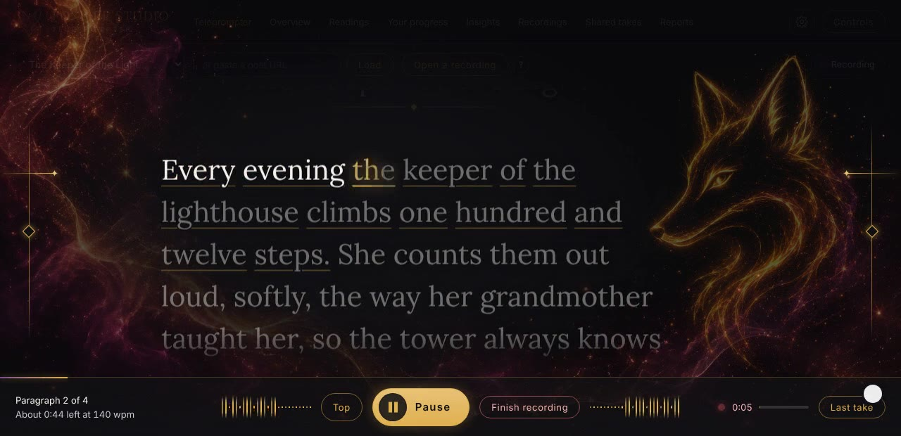

# Foxfire Studio

A teleprompter and recording studio that lives inside WordPress. Pick a post, read it aloud while each word lights up in turn, and get back a clean, podcast-ready MP3 with an honest review of how the reading went.

<a class="button" href="https://github.com/FoxfireRising/Foxfire-Studio/releases/latest">Download the latest release</a>
<a class="button quiet" href="videos.html">Watch the short videos</a>

## Where to start

- **New here?** [Start here](guide/start.md) says which guides to read first, for the person who runs the site and for the person who reads aloud.
- **Ready to record?** [Make your first reading](guide/first.md) goes from a post to a finished MP3 on that post, in one sitting.
- **Every guide** is listed on the [guides page](guide/README.md), in groups.

## Installing

1. Download `foxfire-studio-<version>.zip` from the [latest release](https://github.com/FoxfireRising/Foxfire-Studio/releases/latest). Leave it zipped.
2. In WordPress: Plugins, then Add New Plugin, then Upload Plugin. Choose the zip, install, activate.
3. A short setup offers itself on first visit. After that, open the studio from Tools, then Teleprompter, or the *Teleprompter* link under any post.

It needs WordPress 6.0 or later, PHP 7.4 or later, and a current Chrome, Edge, Firefox or Safari for the person reading. The full instructions, including updating and keeping the studio's files on your own site, are in [Setup](SETUP.md).

## Privacy

Recording, cleanup and the Whisper review run in the reader's own browser, and a recording reaches the site only when the reader chooses to put it there. Listener stats are off until you switch them on, and stay on your own site. Everything the plugin stores, and what it sends where, is in [PRIVACY.md](https://github.com/FoxfireRising/Foxfire-Studio/blob/main/PRIVACY.md). How it was checked for people who use a keyboard or a screen reader is in [Accessibility](ACCESSIBILITY.md).

## Help and ideas

Problem reports and ideas go under [Issues](https://github.com/FoxfireRising/Foxfire-Studio/issues). Foxfire Studio is made and looked after by one person, so replies come when they can. Security problems are reported privately, as [SECURITY.md](https://github.com/FoxfireRising/Foxfire-Studio/blob/main/SECURITY.md) describes.
